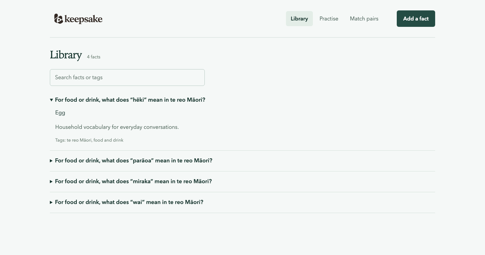
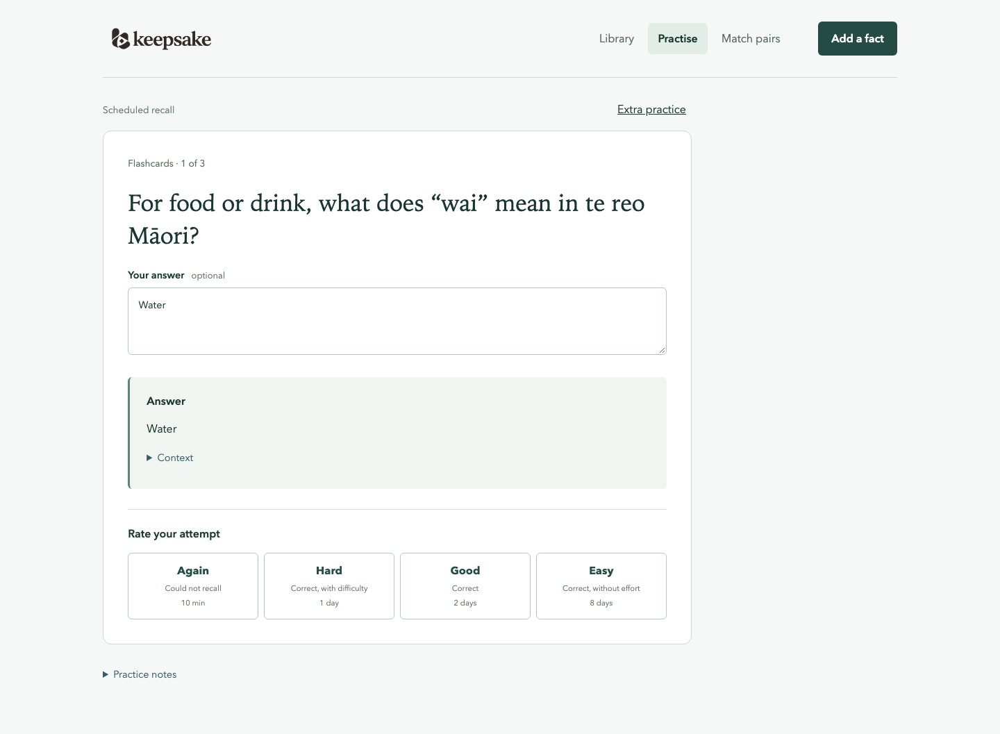
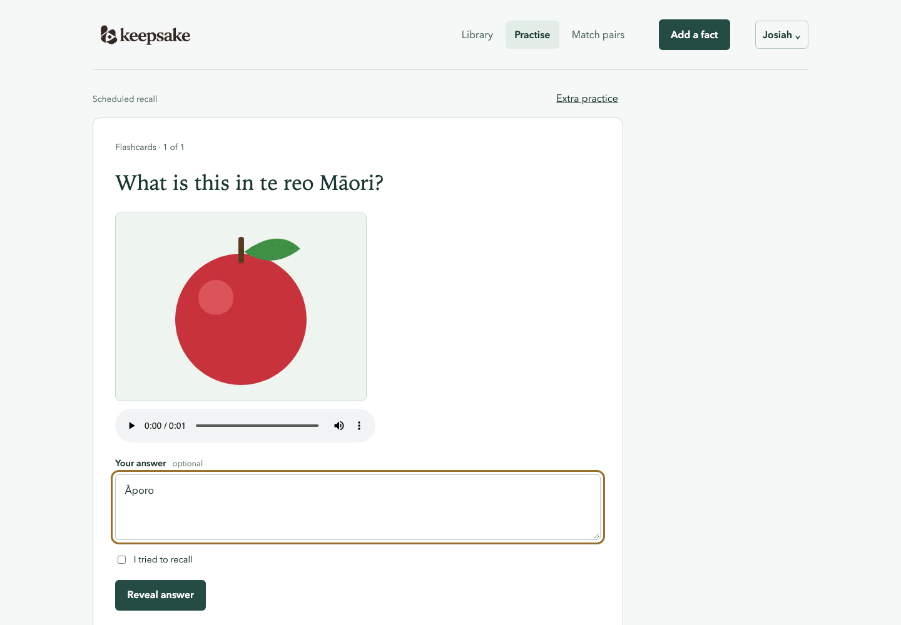
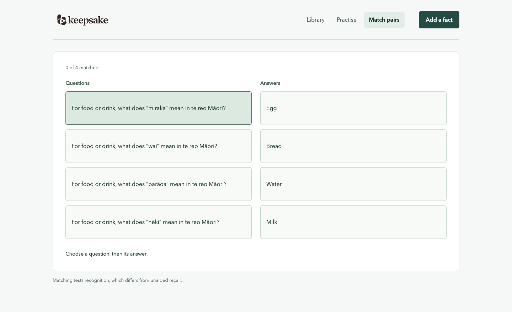

# Keepsake

A personal library for storing facts and practising recall, explanation, and application.
The TypeScript website builds to static files served by a Rust/Axum backend with SQLite.

## Screenshots

Example household vocabulary in the library:



Scheduled recall with feedback and the next review intervals:



A question asked with a picture and an audio clip:



Matching questions and answers from the same topic:



## Install

Download the CLI for your platform from [Releases](https://github.com/JosiahBull/keepsake/releases/latest).
Verify its archive against the release's `SHA256SUMS`, extract it, and put `keepsake`
on your `PATH`. Linux, macOS, and Windows binaries are available.

The container image is `ghcr.io/josiahbull/keepsake:0.7.0` for Linux amd64 and arm64.
From a checkout, start it with persistent SQLite storage using:

```sh
docker compose pull
docker compose up -d
```

Open http://localhost:8080. The CLI can also be built independently from source:

```sh
cargo install --git https://github.com/JosiahBull/keepsake --tag v0.7.0 keepsake-cli --locked
```

## Capture a fact

From this repository:

```sh
pnpm keepsake --profile default add \
  --prompt 'What distinguishes spaced practice from massed practice?' \
  --answer 'Spaced practice distributes learning across separate occasions; massed practice groups it together.' \
  --context 'Choose meaningful gaps based on the material and retention goal.' \
  --source 'docs/research/learning-and-retention-2026-10-24.md' \
  --tag learning
pnpm keepsake --profile default list
pnpm keepsake --profile default show FACT_ID
```

Capture works without a running server. Every fact gets a flashcard, retains its source
and context, and appears in the website when the library loads. Reload the library after
adding facts from another process. `--json` prints machine-readable output.

Install the standalone command to use it from any directory:

```sh
cargo install --path packages/cli --bin keepsake --locked
keepsake --profile default add --prompt 'Your question' --answer 'Your answer'
```

### Images and audio

A question can include images or audio clips, such as a photo to name or a word to
recognise by ear. They appear with every practice format and in matching.
Choose them under Images and audio when adding a fact, or pass them to the CLI:

```sh
keepsake --profile ansam add --prompt 'Which bird is this?' --answer 'Kererū' \
  --media kereru.jpg --media kereru-call.m4a
```

Keepsake accepts still JPEG, PNG and WebP images and MP3, M4A, AAC, WAV, Ogg, WebM and
FLAC clips. Each file declares its type, through `Content-Type` for the API or its
extension for the CLI, and must decode as that type. Renamed, truncated and damaged
files are refused, as are GIFs, animated images and videos. Limits:

| Limit | Value |
| --- | --- |
| File size | 5 MiB |
| Image size | 4096 pixels on each side |
| Clip length | 5 minutes |
| Media per question | 4 |
| Media per profile | 1 GiB |

Every upload is converted to one format for serving, and the upload itself is not kept:

| Upload | Served as |
| --- | --- |
| Image | AVIF, at most 2048 pixels on the long edge, turned upright from its EXIF orientation, with metadata such as location removed |
| Audio clip | AAC-LC in MP4 (`.m4a`), 56 kbit/s a channel, at most two channels and 48 kHz |

The clip's index comes before its audio, and the server answers byte ranges, so playback
and scrubbing start at once. AVIF needs Safari 16 or a current Chrome, Edge or Firefox.
Describe an image for screen readers without giving away the answer.

Media files live beside the database, in the same directory: `media/images/` and
`media/audio/`, named by the hash of their contents. Uploads arrive in `tmp/`, which the
server empties when it starts; it also removes media files that nothing references.
SQLite holds only what describes each file. Accepted shares reuse the sender's file.
An upload that is never attached to a fact is removed after a day.

The CLI is the `keepsake-cli` workspace package and builds independently with
`pnpm build:cli`. It shares fact types and SQLite storage with the server through
`keepsake-core`; neither executable depends on the other.

The standalone CLI defaults to `data/keepsake.db` in the current directory.
Use `--database sqlite:/absolute/path/keepsake.db` or `DATABASE_URL` to select a
SQLite file. The repository and skill launchers select this checkout's database
from any directory. Point the CLI and server at the same file to access the same household profiles.
There is no remote HTTP CLI mode.

### Delete a fact

Deleting a fact removes it with its practice variants, reviews, schedule and study
history. Only a backup brings it back. The CLI prints what it deleted, so the content can
be saved again, as a new fact with a fresh schedule. A deleted fact's ID is never reused.

```sh
keepsake --profile default delete FACT_ID
curl -X DELETE http://localhost:8080/api/profiles/1/facts/FACT_ID
```

Offers of the fact still awaiting an answer are withdrawn. Copies other profiles have
accepted stay. Images and clips that no other question uses stop being served, and the
server removes their files when it next starts.

## Household profiles

Each profile has a separate fact library, recall history, timezone, and study budget.
Josiah and Ansam are created automatically. On a fresh database, Josiah starts with
40 Rust/Linux facts and Ansam with 60 household te reo Māori facts. Ansam’s vocabulary
also appears as 60 pending offers in Josiah’s inbox; accepting creates independent copies.
The header switcher changes the active profile; each browser tab keeps its own selection.
Profiles use no passwords: anyone who can access the app can switch between them.

```sh
keepsake profiles list
keepsake --profile ansam list
keepsake profiles create 'Guest' --handle guest
keepsake --profile ansam add --prompt 'What does wai mean?' --answer 'Water'
keepsake --profile ansam due
```

Use `--profile ID_OR_HANDLE` or `KEEPSAKE_PROFILE` for all library and study commands.
The sole profile is the compatibility default. With multiple profiles, capture stops
before fetching a URL, invoking an agent, or saving facts unless an owner is selected.
Keep that same profile when importing reviewed JSON or generating practice.

Sharing sends an offer; it adds nothing to the recipient’s library until accepted:

```sh
keepsake --profile ansam share FACT_ID OTHER_FACT_ID --to default
keepsake --profile ansam shares list --sent
keepsake --profile default shares list
keepsake --profile default shares accept SHARE_ID
keepsake --profile default shares accept-batch SHARE_ID OTHER_SHARE_ID
keepsake --profile default shares decline SHARE_ID
keepsake --profile ansam shares withdraw SHARE_ID
```

Accepted copies retain source, context, tags, and practice content, with fresh recall
schedules. Reviews and approval status for generated recall prompts are not copied. Copies stay
independent; later edits or offers never overwrite the recipient’s facts or progress.
Reuse `share --submission-id UUID` when retrying the same offer. Accepting the same
share again returns its existing copy. See [profiles](docs/profiles.md) for migration
and backup behavior.

## Back up and restore

Create a backup before upgrading. Choose an existing destination directory:

```sh
keepsake --database sqlite:/absolute/path/keepsake.db backup /backups/keepsake-2026-10-24.db
mkdir /restored
keepsake restore /backups/keepsake-2026-10-24.db --to /restored/keepsake.db
```

`backup` captures a consistent whole-household SQLite snapshot while the server is running,
including every profile, library, schedule, share state, and committed WAL data.
`--profile` does not limit a backup or restore. Both commands check database integrity
and foreign keys before publishing the file. They preserve IDs, reviews and migration history, run no migrations,
and refuse existing destinations or SQLite sidecars. Snapshot files are private to the
current user on Unix. Keep copies on another volume with retention appropriate to your library.

Images and audio go to a `-media` directory beside the backup, such as
`/backups/keepsake-2026-10-24.db-media/`; keep the two together. Each file is checked
against its hash when it is backed up and when it is restored, and a damaged or missing
file stops either command. Restore into a directory of its own, without a `media/`
folder: the restored database keeps its media there, and the server removes media files
its own database does not reference.

Restore to a new directory, inspect its profiles with `keepsake --database sqlite:/restored/keepsake.db profiles list`,
and each library using `--profile ID_OR_HANDLE`. Stop the server before switching `DATABASE_URL` to that file and restarting.
Keep the original until you have verified the restored library. Do not copy only the live
database file: committed changes may still be in its WAL. Container users can run the CLI
inside the container with a writable backup directory mounted alongside `/data`.

## Add from a URL

```sh
keepsake --profile default add --url 'https://example.com/article' \
  --prompt 'Remember the main ideas, definitions, and important exceptions' \
  --tag reading
```

URL capture defaults to Claude Haiku. Add `--agent codex` for Luna. `--prompt` describes
what to remember; no `--answer` is needed. `--limit 5` sets the maximum number of facts
(default 5, maximum 20).

To inspect before saving:

```sh
keepsake --profile default add --url 'https://example.com/article' \
  --prompt 'Focus on the key mechanisms' --agent codex --dry-run > facts.json
keepsake --profile default add --file facts.json
```

Keepsake fetches readable page text and sends it with your prompt to the selected agent.
Each fact keeps the original URL, a supporting source excerpt, and your tags. The excerpt
must occur in the fetched text; this check does not prove the generated answer is accurate.
All facts are validated and saved in one transaction. A failed import saves none.

Supports UTF-8 HTML, plain text, and Markdown over HTTP/HTTPS. It does not render JavaScript,
sign in, or read PDFs. Fetches have a 30-second deadline, five-redirect limit, 2 MiB download
cap, and 120,000-byte readable-text cap. Oversized pages are rejected rather than truncated.

## Draft varied practice with an agent

Both integrations use the installed CLI's existing login. Claude uses the `haiku` alias;
Codex uses `gpt-6-luna`. Manual capture calls a model only when `--agent` is supplied.

```sh
keepsake --profile default add --prompt 'Your question' --answer 'Your answer' \
  --context 'The source material and qualifications' --source 'A citation' \
  --agent claude --dry-run > draft.json
# Inspect and correct draft.json against your source, then save that exact content:
keepsake --profile default add --file draft.json

# Draft variants for an existing fact with Codex Luna:
keepsake --profile default generate FACT_ID --agent codex --dry-run > practice.json
keepsake --profile default generate FACT_ID --file practice.json
```

Without `--dry-run`, `add --agent ...` saves the fact and generated variants together,
and `generate ID --agent ...` appends variants immediately. These variants are unverified
practice, available through Extra practice. They do not supply scheduled recall evidence
until checked and approved as equivalent prompts. The original fact and
answer are preserved. Review new prompts, expected answers, explanations, and plausible
wrong choices against the source before relying on them.

`--model` overrides the selected agent's model. `--timeout-seconds` sets a 1–600 second
deadline (default 120); `--agent-command` selects an executable for custom installations.
On Windows, include the extension for npm shims, for example `--agent-command codex.cmd`.
Input is passed through stdin, with no shell interpolation. Agent stdout is capped; stderr is drained without retaining it.
Invalid output or generation failure does not partially save a new fact. A provider
call sends the supplied fact, context, and source to that provider.

`add --file -` and `generate ID --file -` accept JSON through stdin. `add` accepts one
`NewFact` or an array of up to 20; `generate` accepts one. The shape is in the OpenAPI schema. `keepsake methods` describes the supported modes.

## Practise

Practise starts a server-selected due queue using FSRS in Rust. Each fact has one recall
schedule, shared by its approved equivalent prompts. Defaults are 90% desired retention,
five new targets per local day, and a soft 15-minute daily budget. Again returns a target
after ten minutes; successful recall uses the model's interval. Nothing is retired
automatically. See [scheduling](docs/scheduling.md) for policy and history details.

Type an answer or confirm a spoken attempt before revealing feedback. Viewing an answer
without attempting it records exposure, with no successful recall rating. Hard means
correct recall with difficulty; an incorrect answer means Again. Feedback is saved before
the answer is shown, so reloading before grading preserves that exposure. Ratings save in
the background, in the order you made them, so the next question appears straight away.
A failed save holds back later saves until you retry it, and Keepsake warns before you
leave with ratings unsaved.

Short sounds mark an answer appearing, a rating, the end of a session and a failed save.
Every rating sounds the same; only multiple choice and matching sound right or wrong.
Turn sounds off for a device in Profile settings. On iPhone, the silent switch mutes them.

Extra practice offers flashcards, multiple choice, fill-the-gap, explanation, and application
without advancing the recall schedule. Matching draws three or four related facts from one topic tag,
preferring the smallest topic with enough distinct question–answer pairs and similar question
patterns within it. Add a shared tag such as `food` or `cargo` to build a matching bank.
Rounds never pad a small bank with unrelated facts.

Matching, choice, and answer browsing cannot stand in for unaided recall. They record
exposure and temporarily defer assessment of that fact for ten minutes, without changing
its model due date. Review history retains each activity's method and conditions.

```sh
keepsake --profile default due
keepsake --profile default --json due --limit 5
keepsake --profile default study settings --timezone Europe/London --new-limit 5 --daily-budget-seconds 900
keepsake --profile default study approve PRACTICE_ID
keepsake --profile default study submit --file attempt.json
keepsake --profile default study events --after 0 --limit 100
```

Only the canonical flashcard starts as scheduled evidence. After checking an equivalent
flashcard or cloze against its source, `study approve` permits it to share that schedule.
Generating additional variants creates no additional review obligations. Reuse the exact
submission JSON, including its UUID, when retrying `study submit`.

[Learning design](docs/learning-design.md) explains the rationale and limitations, based on
the [saved research](docs/research/learning-and-retention-2026-10-24.md). The research supports
retrieval, feedback, and spacing; the particular mix of formats is a product proposal.

Library reads use bounded pages. `keepsake --profile default list --search 'sqlite' --limit 25` searches
questions, answers, context, and tags. Search treats `%` and `_` literally and matches
ASCII and Māori macron vowels regardless of case. Other non-ASCII letters
are case-sensitive. JSON output is `{items, next_cursor, total}`;
continue with `--before NEXT_CURSOR` and the same search until the cursor is null.
`list` accepts 1–100 facts per page; `show ID` includes that fact's practice variants.

The website's library loads the next 25 facts as you scroll towards the end. Due queues
contain up to 20 eligible targets; Extra practice samples up to 20 prompts across formats.
Neither queue depends on the library's search or how far it is scrolled. Review-history
requests return up to 50 reviews by default (maximum 100), with `after_id` for the next page.

## Install on a phone

Keepsake installs from the browser as a Home Screen app. The server must be reachable
over HTTPS; browsers allow service workers and notifications only on secure origins.

- **iPhone and iPad:** open Keepsake in Safari, tap Share, then Add to Home Screen.
- **Android:** open Keepsake in Chrome, open the menu, then choose Add to Home screen.

The installed app opens without browser controls. Starting it offline shows Keepsake's
connection error rather than a browser error page; nothing is saved offline.

Turn on reminders in Profile settings. On iPhone and iPad this needs iOS 16.4 or later,
and Keepsake must be opened from its Home Screen icon. Each profile gets at most one
reminder a day, sent once reviews or new facts are ready, between its chosen time and
midnight in its study timezone. No reminder is sent after that day's study budget is
spent. Tapping it opens scheduled practice. On iPhone and iPad, the icon's badge counts
ready reviews and new facts. Several household profiles can share one phone, and each
profile can receive reminders on several devices.

On Android, long-press the icon for Practise, Add a fact and Match pairs. Sharing a page
or text to Keepsake opens the fact form with its title, text and address filled in.
Neither is available on iOS.

The server sends reminders through each browser's push service, such as
`web.push.apple.com` or `fcm.googleapis.com`, so it needs outbound HTTPS. It creates its
push signing key on first use and stores it in SQLite; backups keep it, so restored
subscriptions keep working. [Scheduling](docs/scheduling.md#reminders) explains how the
reminder policy relates to the saved research.

## Agent skill

The canonical [keepsake-add-facts skill](skills/keepsake-add-facts/SKILL.md) is stored here.
Install or update its copies in `~/.claude/skills` and `~/.codex/skills` with:

```sh
pnpm skills:install
```

The skill launcher works from any directory. Set `KEEPSAKE_REPO` if the checkout moves.

## Connect an agent (MCP)

An agent such as Claude Code can search a profile's library over the Model Context
Protocol and, if allowed, add facts and practice variants. Everything it reads goes to its
model provider, so this is off unless the server sets `KEEPSAKE_MCP` to `read` or `write`
and the profile then chooses its own access in Profile settings, which shows the address
and the command to connect. Agents cannot record reviews, approve variants, share or change
settings. See [Agent access](docs/mcp.md) for the rules, tools and network checks.

## Develop

Install Rust, Node 24 or newer, and pnpm 11. From the repository root:

```sh
pnpm install
pnpm gen:client
pnpm dev
```

Open http://localhost:5173. Vite proxies `/api` to the backend on port 8080.
The backend rebuilds on Rust and migration changes; the frontend reloads through Vite.

Builds check static SQL against committed `.sqlx` metadata, without opening a database.
After changing queries or migrations, regenerate metadata against a temporary schema:

```sh
cargo install sqlx-cli --version 0.9.0 --locked --no-default-features --features sqlite
pnpm sqlx:prepare
pnpm sqlx:check
```

The preparation script ignores `DATABASE_URL` and `.env` settings and deletes its temporary
database afterwards. Commit the updated `.sqlx` files with the query or migration change.

## Build and run

```sh
pnpm build
WEB_DIR=packages/web/dist ./target/release/keepsake-server
```

Open http://localhost:8080. The Rust process serves both the static website and the API.
Node is only needed to build the frontend.

| Variable | Default | Purpose |
| --- | --- | --- |
| `DATABASE_URL` | `sqlite:data/keepsake.db` for the server | SQLite file location; its directory also holds `media/` and `tmp/` |
| `KEEPSAKE_PROFILE` | Sole profile when unambiguous | CLI library owner; overridden by `--profile` |
| `BIND_ADDR` | `127.0.0.1:8080` | HTTP listening address |
| `WEB_DIR` | `packages/web/dist` | Built frontend directory |
| `RUST_LOG` | `info` | Server log filter |
| `SHUTDOWN_GRACE_SECS` | `10` | Shutdown budget for HTTP draining and database closure |
| `HEADER_READ_TIMEOUT_SECS` | `15` | Deadline for receiving an HTTP request head |
| `CONNECTION_TIMEOUT_SECS` | `120` | Maximum connection lifetime, including keep-alive and blocked writes |
| `REQUEST_TIMEOUT_SECS` | `30` | Request deadline after headers, including body receipt and handler work |
| `MAX_CONNECTIONS` | `128` | Concurrent TCP connections |
| `MAX_IN_FLIGHT` | `32` | Concurrent requests; excess requests receive 503 with `Retry-After` |
| `MAX_BODY_BYTES` | `524288` | Request-body size limit in bytes; media uploads have a fixed 5 MiB limit |
| `PUSH_CONTACT` | `https://github.com/JosiahBull/keepsake` | `mailto:` or `https:` contact sent to push services with each reminder |
| `KEEPSAKE_MCP` | `off` | Most agent access any profile may choose: `off`, `read` or `write`. See [Agent access](docs/mcp.md) |
| `KEEPSAKE_MCP_ALLOWED_HOSTS` | none | Comma-separated host names MCP clients may use besides loopback |

Run the server from the repository root with its defaults. `.env` files are not loaded
automatically. Embedded, append-only migrations run on startup. SQLite uses WAL, foreign
keys, and a four-connection pool. Keep the database on local persistent storage.

Missing database files and parent directories are created on startup. The database
directory must be writable, including for SQLite's WAL files. The container runs as
UID/GID `10001:10001`; bind-mounted storage must grant that user write access.
The default Compose named volume is initialized with the image's directory ownership.
One database per directory: the server removes media files in its directory that its own
database does not reference.

An explicitly configured `WEB_DIR` must contain a readable `index.html`; startup fails
before opening SQLite when it is missing. With `WEB_DIR` unset, the development API can
start before the frontend is built. [`.env.example`](.env.example) lists the defaults.
Duration settings accept 1–3600 seconds; connection and request counts accept 1–16384;
the body-size setting accepts 1–16777216 bytes. Invalid settings fail startup.

SIGINT or SIGTERM starts graceful shutdown. A second signal forces shutdown. The grace
budget includes closing SQLite; runtime cleanup can take up to one additional second.
Give the container or service manager a longer stop grace than this combined budget.

```sh
keepsake-server --health-check
```

The probe asks the running `/api/health` endpoint, with a two-second deadline and bounded
response headers. It bypasses startup configuration, never opens SQLite, and maps wildcard
bind addresses to loopback. The endpoint itself checks the running server's database.

API failures use JSON, with `X-Request-ID` for log correlation. Request summaries record
method, route template, status and duration without query strings, headers or fact content.
API responses are `no-store`, except question media, which only the browser may cache;
fingerprinted frontend assets are immutable and the shell revalidates. Browser security
headers apply to ordinary responses and rejections. These controls do not add
authentication or cross-origin access.

The Dockerfile packages both Rust binaries and the website into one image. `compose.yaml`
mounts `/data` for persistence. CI builds and smoke-tests the container before release.
Agent executables are not installed in the image. There is no authentication yet; the
provided host binding is loopback. Use SQLite's backup API or stop the process before
copying its data directory: WAL files can contain committed data outside the main file.

## Project layout and checks

- `packages/web`: Svelte 5 and TypeScript, built with Vite
- `packages/client`: generated API types and an `openapi-fetch` client
- `packages/server`: HTTP routes and static website serving
- `packages/cli`: standalone `keepsake-cli` package, source imports and agent integration
- `packages/core`: shared fact types, validation and SQLite repositories
- `packages/mcp`: MCP tools for agents, mounted by the server
- `packages/core/migrations`: append-only SQL migrations embedded in both binaries
- `skills/keepsake-add-facts`: reusable capture workflow

`pnpm gen:client` generates OpenAPI from Rust and then the TypeScript contract. Commit the
schema and generated types together. The API exposes facts, practice variants, reviews,
health, and OpenAPI. Unknown API routes return 404 rather than the SPA. Static SQL queries
are checked against the committed offline SQLx metadata. `pnpm sqlx:check` verifies it
against a temporary database built from migrations.

```sh
pnpm --filter @keepsake/web exec playwright install chromium webkit
pnpm check
pnpm test
```

Install browsers once. `pnpm test` runs Rust tests and the browser suite.
Tests use temporary databases and fake agent executables to cover persistence, validation,
API boundaries, exact draft import, subprocess failures, deadlines, and output limits.
Browser tests drive the built website through the real Rust server in desktop/mobile
Chromium and mobile WebKit, covering fact capture, practice, matching and recovery.
See [Browser tests](docs/testing.md) for commands, visual baselines and failure reports.
The supplied research is preserved with its original citations; saving it did not
independently verify its claims.

See [Releases](docs/releasing.md) for the versioning and publication workflow.
