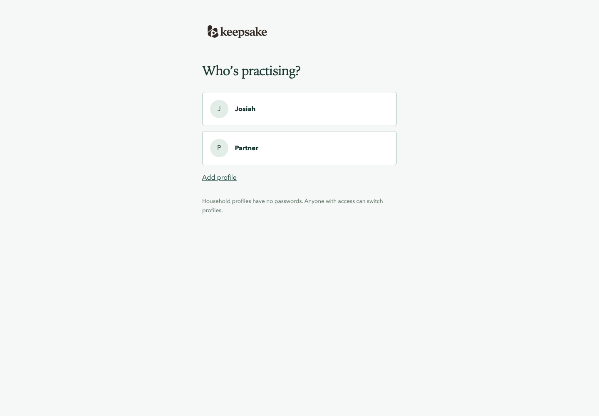
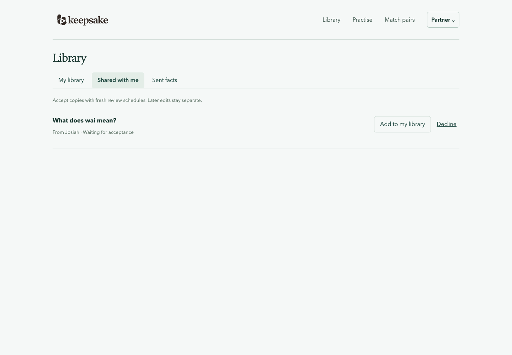

# Household profiles

Profiles separate libraries and learning histories in one SQLite database. They are
household names without passwords, so they prevent accidental mixing rather than
restrict access to other household members.

## Browser views





## Default libraries and upgrades

A fresh database creates Josiah (handle `default`) with 40 Rust/Linux facts and
Ansam (handle `ansam`) with 60 household te reo Māori facts. Ansam’s vocabulary is
offered to Josiah as 60 pending shares. Accepting adds independent copies to
Josiah’s library; the offers do not add review obligations before acceptance.

Before upgrading, create a whole-household backup with `keepsake backup PATH`.
The untouched placeholder is named Josiah; existing named members are reused.
Original te reo facts in Josiah’s library move to Ansam with their IDs, schedules,
reviews, and exposure history intact. Accepted copies stay with their recipients.
Other profiles and existing study settings are preserved.

Missing default facts and pending offers are added once. Existing wording and
practice variants are retained; reopening does not duplicate facts or offers.

Each newly created additional profile starts empty with default study settings:

```sh
keepsake profiles list
keepsake profiles create 'Guest' --handle guest
```

Handles and numeric IDs stay stable when display names change. Profile deletion
is not supported.

## Select a library

The browser carries the selected profile in its URL, so switching one tab does not
change another. It clears loaded facts, practice, matching, and answer state when
switching. Unsaved answers need confirmation before being discarded. Writes and
failed retries remain tied to their original profile.

Reminders also belong to a profile. Turning them on adds the current browser for the
selected profile only. Profiles sharing a phone each receive their own reminder, and
turning one off leaves the others on.

The Rust CLI accepts `--profile ID_OR_HANDLE` globally. `KEEPSAKE_PROFILE` supplies
the default; an explicit flag takes precedence. Run `keepsake profiles list` to see
IDs and handles. A sole profile can be selected automatically for compatibility.
The default household has two profiles, so an unscoped content or study command
fails with a profile-selection error. Capture requires a selection before the
first database is created, URL fetching, or external agent work. Binding the owner before such
work also keeps capture in the intended library if another profile is later created.

## Share facts

Choose Select in your library, tick up to 20 facts and choose Share selected, then
the recipient. To share one fact, use the Share action on its row. The offer contains a frozen
copy of their question and its images and audio, answer, context, source, tags, and
practice content. The
recipient’s inbox shows questions with answers hidden until accepted. They can
accept one or several offers, or decline. Senders can withdraw pending offers.

Acceptance creates an independent owned fact with a fresh schedule. It copies no
reviews, successful recall history, cooldowns, or generated-prompt approvals. The
recipient's library records each image and clip, sharing the sender's file, and counts it
against their storage. A retry
of an accepted offer returns the same copy. Later edits and new offers cannot replace
an existing accepted copy or its progress. Decline and withdrawal leave libraries
unchanged. There is no live synchronization or automatic merging of duplicate facts.

Deleting a fact withdraws its pending offers; accepted copies stay with their recipients.
A recipient who deletes their copy leaves the offer accepted for both profiles, and
accepting it again does not make another copy.

CLI equivalents:

```sh
keepsake --profile ansam share 12 13 --to default --submission-id UUID
keepsake --profile default shares list
keepsake --profile default shares accept-batch SHARE_ID OTHER_SHARE_ID
keepsake --profile default shares decline SHARE_ID
keepsake --profile ansam shares list --sent
keepsake --profile ansam shares withdraw SHARE_ID
```

Keep the same UUID and fact IDs to retry an offer. Each accepted share is idempotent,
so repeating acceptance does not create another fact.

## Back up or downgrade

Backup and restore include the entire household: profiles, libraries, learning history,
settings, pending offers, and acceptance provenance. Images and audio are copied to a
`-media` directory beside the backup file. They never filter by
`--profile`. There is no per-profile backup/export-and-restore operation.

To downgrade, restore the pre-upgrade backup to a new database path and stop the
server before switching `DATABASE_URL`. Keep the upgraded database because restoring
an older backup omits subsequent changes. Do not open a migrated database with an
older binary.
